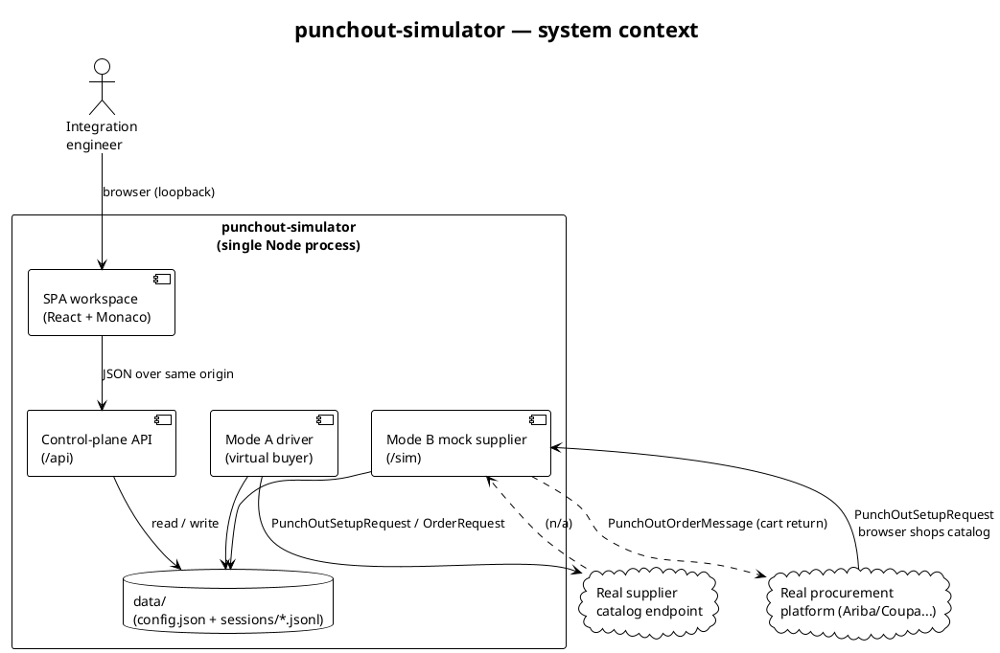
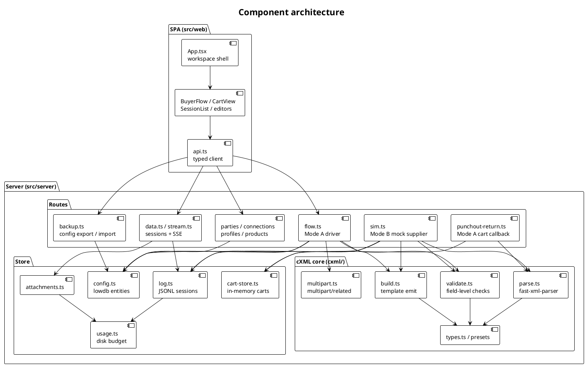
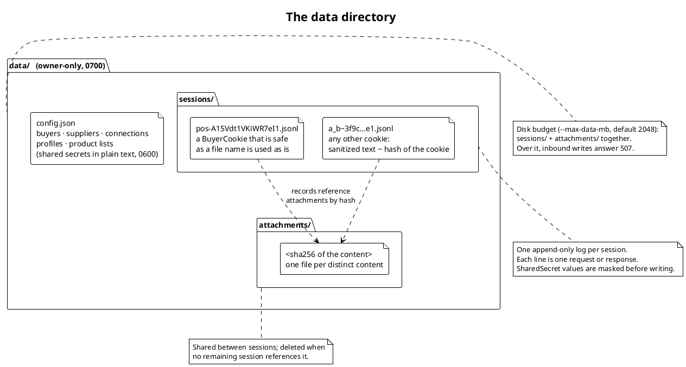
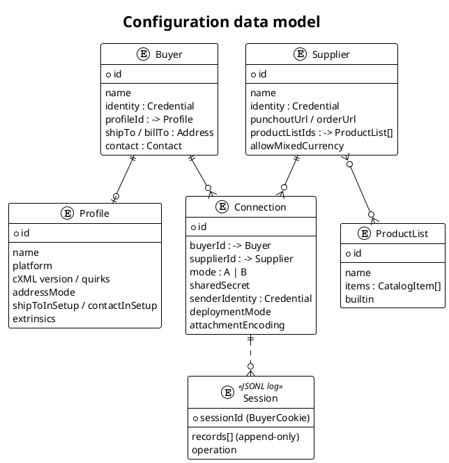
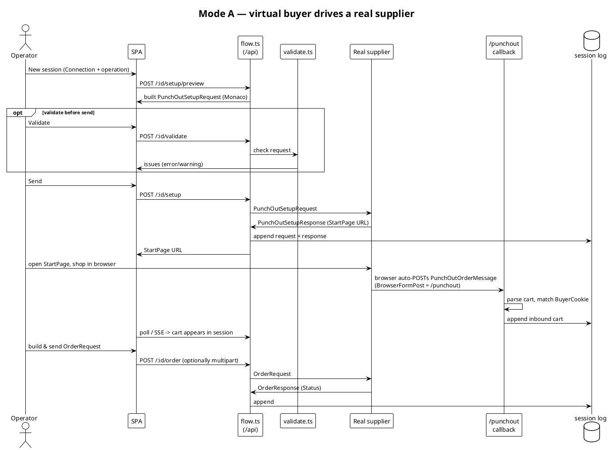
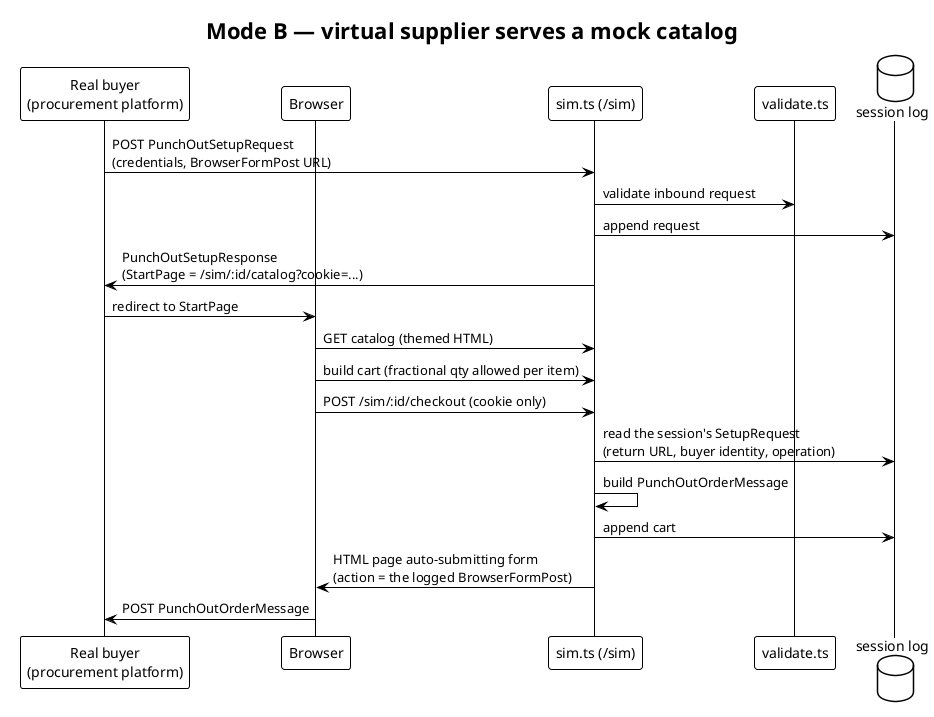
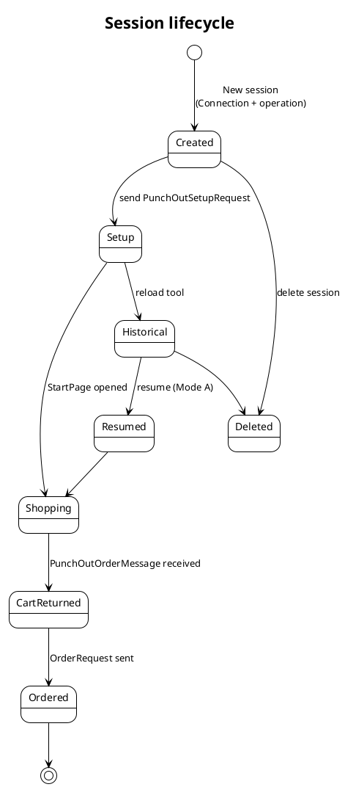
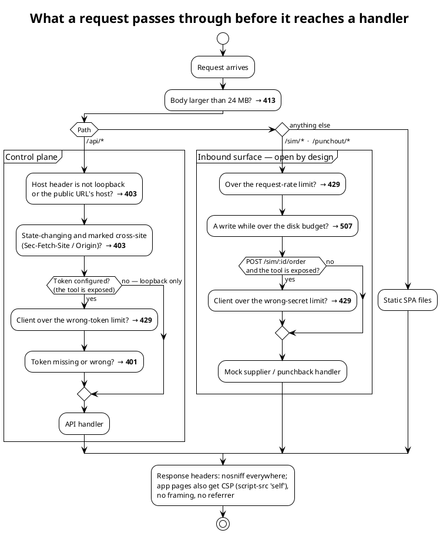

## Overview

**punchout-simulator** is a single-process developer tool for testing cXML
PunchOut integrations. It plays the part of a *virtual counterparty*: it can
behave as a **virtual buyer** that drives a real supplier's catalog
(**Mode A**), or as a **virtual supplier** that serves a mock catalog to a real
procurement platform (**Mode B**). Either way, the operator works against one
honest, inspectable end of a PunchOut conversation while the other end is the
real system under test.

The whole tool ships as one npm package. A Node process (Hono HTTP server)
serves both a JSON control-plane API and a built single-page application from
the same origin; the SPA is a React + Vite + Monaco workspace for composing,
sending, and inspecting cXML documents.

> [!NOTE]
> This document describes the *technical* architecture. For the business
> context — what PunchOut is and where this tool sits in a procurement
> workflow — see the **PunchOut business primer**. For day-to-day usage
> (sessions, operations, profiles, product lists), see the **Operations &
> usage guide**.

### Design constraints

The architecture is shaped by a few deliberate constraints:

- **cXML-only.** The tool speaks cXML PunchOut end to end. OCI and other
  protocols are out of scope (they are discussed in the business primer for
  contrast only).
- **Single process, local-first.** One `node` process, one `data/` directory.
  No external database, no message broker, no container orchestration. It runs
  on a developer laptop with `npx punchout-simulator`.
- **Loopback by default, token when exposed.** The control plane binds to
  loopback. The moment it is exposed on a non-loopback address, `/api` is gated
  behind a token. The inbound buyer-facing surface (`/sim`, `/punchout`) stays
  open so a real buyer system can reach it.
- **Append-only, inspectable history.** Every message in a conversation is
  appended to a per-session JSONL log. Nothing is destructive except an explicit
  session delete.

## System context

At runtime the simulator is one server that faces two directions. Toward the
operator it serves the SPA and the control-plane API. Toward the network it
either calls out to a real supplier (Mode A) or receives calls from a real
buyer (Mode B).

*Fig. 1: The simulator faces the operator (SPA + API) and the network (Mode A calls out to a real supplier; Mode B is called in by a real buyer).*

## Component architecture

Internally the server is a set of Hono route modules over a small cXML core and
a file-backed store. The SPA is a flat React app talking to those routes through
a single typed `api` client.

*Fig. 2: Route modules sit over a shared cXML core (build / parse / validate / multipart) and a file-backed store.*

Two SPA conveniences worth knowing about architecturally: every cXML field is
rendered through a shared `CxmlEditor` component that carries a **Copy +
Prettify** toolbar (prettify is local and display-only on read-only fields),
and a session's flow can be **exported as a PDF** — `flow-pdf.ts` renders a
self-contained print-ready HTML report (validation results, HTTP statuses,
attachments, timestamps) and hands it to the browser's native print-to-PDF, so
the tool takes no PDF library dependency.

### The cXML core

The `cxml/` package is protocol logic with no HTTP or storage knowledge:

| Module | Responsibility |
|---|---|
| `build.ts` | Emits cXML documents from typed inputs using template literals. Handles `PunchOutSetupRequest`, `OrderRequest`, address/contact blocks, classification blocks, and line-item totals (returns `0` for mixed-currency carts). |
| `parse.ts` | Parses inbound cXML with `fast-xml-parser`. XXE is rejected. |
| `validate.ts` | Bidirectional, field-level validation against expectations: credentials (only on header-bearing docs), single-currency, address completeness, operation/items coherence. Produces typed issues (error / warning). |
| `multipart.ts` | Hand-assembles and parses `multipart/related` for `OrderRequest` attachments. |
| `types.ts` + `*-presets.ts` | The shared domain types and the built-in presets. Profile presets ship for Generic, SAP Ariba, Coupa, Jaggaer (two `UserAgent` variants: `JAGGAER` and legacy `SciQuest`), Oracle iProcurement, SAP SRM / Business Network, and Workday — one source of truth for both the rows seeded into `config.json` and the in-memory fallback. |

### The store

State lives in a single `data/` directory:

- **`config.json`** — a normalized lowdb document holding the entity tables
  (`buyers`, `suppliers`, `connections`, `profiles`, `productLists`), stamped
  with a `schemaVersion`. Versioned migrations run at boot (legacy flat
  connections → normalized Buyer/Supplier/Connection rows, inline-catalog →
  product list, `unspsc` → classifications, profile address-mode backfill), and
  a file written by a newer build is refused rather than downgraded.
- **Export / import** (`routes/backup.ts` over `exportConfig` / `importConfig`)
  snapshots those five tables as one JSON file with a small envelope (`format`,
  `schemaVersion`, `exportedAt`, `appVersion`). Import runs the *same* migration
  chain (`upgradeSchema`) on the incoming document, so files from older versions
  load; it validates the whole result — id format, duplicates, connections'
  buyer/supplier references — before touching the live store, and either merges
  by id or replaces. Built-ins the file omits are re-seeded but never overwrite
  the store's edited copies on merge.
- **`data/sessions/<sessionId>.jsonl`** — append-only message logs, one file per
  PunchOut conversation (keyed by `BuyerCookie`). Each line is one record
  (request or response, direction-tagged). A `BuyerCookie` is text chosen by
  whoever sends the cXML, so it is only used as the file name when it consists
  of filename-safe characters; any other cookie is stored as
  `<sanitized>~<hash of the cookie>.jsonl`. The `~` cannot occur in a safe id,
  so two different cookies never share a log. Session listings key on the file
  and take the real id from the records inside.
- **Attachments** — stored as separate content-addressed files
  (`attachments/<sha256>`), referenced from records rather than inlined. Because
  they're shared, deleting a session prunes only attachments no remaining
  session references.
- **Disk budget** — `usage.ts` measures `sessions/` + `attachments/` once and
  then tracks every write and delete incrementally; over `--max-data-mb`, the
  open inbound routes stop writing (see [Security posture](#security-posture)).
- **Carts** — held in an in-memory `cart-store` keyed by `sessionId`; the
  durable record of a returned cart is the JSONL log.

*Fig. 3: The data directory — one config file, one log per session, and attachments stored once per distinct content.*

## Data model

The configuration is normalized into independent entities so the same party or
product set can be reused across many integrations. A **Connection** is the unit
under test: it binds one Buyer to one Supplier, fixes which side the tool
simulates (`mode`), and carries the pair-specific credentials and deployment
options.

*Fig. 4: Buyer, Supplier, Connection, Profile and ProductList are normalized config entities; Sessions are append-only JSONL logs anchored to a Connection.*

> [!TIP]
> Endpoints (`punchoutUrl`, `orderUrl`) are *intrinsic to the Supplier* — they
> are the same for every buyer that talks to it, so they live on the Supplier,
> never per-Connection. Pair-specific data (credentials, deployment mode) lives
> on the Connection.

## Message flows

### Mode A — virtual buyer drives a real supplier

In Mode A the operator composes and sends the buyer-side documents; the real
supplier responds. The cart comes back through the browser to the tool's own
`/punchout` callback, which parses it and files it under the session.

*Fig. 5: Mode A — the tool sends buyer documents, the real supplier responds, and the cart returns through the `/punchout` callback.*

### Mode B — virtual supplier serves a mock catalog

In Mode B a real procurement platform calls the tool. The tool answers the
`PunchOutSetupRequest` with a StartPage, serves a themed HTML catalog at
`/sim/:supplierId/*`, and when the operator checks out it builds the
`PunchOutOrderMessage` and auto-POSTs it back to the buyer's `BrowserFormPost`
URL. That URL, like the buyer's identity, is read back from the
`PunchOutSetupRequest` logged for the session — the StartPage link carries only
the `BuyerCookie`, so nothing in a link or a form can change where a cart goes.
The mock supplier also **honours the setup `operation`**: for `edit` it
re-reads the carried `ItemOut` from the session log and pre-fills the catalog
quantities (items it doesn't list show as extra rows); for `inspect` it renders
the carried item(s) read-only and returns them unchanged.

*Fig. 6: Mode B — the tool answers the buyer's setup, serves a catalog, and posts the cart back through the browser to the buyer's form-post URL.*

> [!IMPORTANT]
> `/sim/:id/checkout` **requires a `BuyerCookie` with a `PunchOutSetupRequest`
> on record**. A checkout without a cookie, for a cookie this supplier never
> received a setup for, or for a setup that named no http(s) `BrowserFormPost`
> URL is rejected with `400` and creates no session. This guards against a
> phantom session being minted on every stray request, and it is what ties the
> cart's destination to the buyer's own setup.

## Sessions

A **session** is one PunchOut conversation, identified by its `BuyerCookie`
(used verbatim as the `sessionId`). It is the primary unit the operator works
with: every request and response in the conversation is appended to that
session's JSONL log, and the SPA renders a per-session message log rather than a
global firehose.

*Fig. 7: A session moves from setup through shopping and cart return to order; historical Mode A sessions can be resumed, and any session can be deleted.*

The `operation` attribute (`create` / `edit` / `inspect`) is captured from the
`PunchOutSetupRequest` and shown on the session row. It drives what the outbound
document carries — see the Operations & usage guide for the business meaning of
each.

## Security posture

The tool is built to be safe to run locally and to expose deliberately. It has
two surfaces with different rules: the **control plane** (`/api/*`, the SPA)
and the **inbound surface** (`/sim/*`, `/punchout/*`), which must stay open
because real buyer systems and supplier pages post to it.

*Fig. 8: The checks in the order a request meets them. The control plane authenticates; the inbound surface is bounded instead.*

**Control plane**

- **Exposure gating.** `/api/*` (except `/api/health`) requires the token
  whenever one is configured — which happens automatically on a non-loopback
  `--public-url` or `--host`. The token is accepted as a Bearer header, an
  `x-pos-token` header, or a `?token=` query (for EventSource and download links,
  which can't set headers). It is deliberately **not** accepted from a cookie,
  which would travel with cross-site requests. The request log masks the
  `?token=` value.
- **Token guessing is throttled.** A client that sends 30 wrong tokens in a
  minute is refused (`429`) until the minute is up, without its token being
  compared — otherwise a correct guess would still get through. Once 300 wrong
  tokens have arrived from anyone, every client that has itself sent a wrong one
  is refused too; a client with no failures is never affected, so a stranger
  cannot lock the operator out. Clients are told apart by socket address
  (IPv6 by /64); `X-Forwarded-For` is believed only when the peer is loopback —
  a tunnel agent on the same machine — and then only its last hop. Startup warns
  when a configured token is shorter than 16 characters.
- **DNS-rebinding guard.** `/api/*` only answers when the `Host` header names
  loopback or the configured public URL's host.
- **CSRF guard.** State-changing `/api/*` requests that the browser marks as
  cross-site (`Sec-Fetch-Site`, or a foreign `Origin` from older browsers) are
  rejected with `403`. On a plain localhost run there is no token, and the API
  reads JSON regardless of `Content-Type`, so without this any web page could
  drive it with a "simple" `text/plain` POST. Same-origin SPA calls and
  non-browser clients (no such headers) pass.
- **Content-Security-Policy.** The app's own pages are served with
  `script-src 'self'` (plus `object-src 'none'`, `base-uri 'none'`,
  `form-action 'self'`). cXML bodies and imported configuration are
  attacker-influenced text; if an escaping bug ever let some through as markup,
  no injected inline script or event handler would run. The SPA therefore
  carries no inline script: the theme bootstrap is a same-origin file and the
  PDF export is printed by its opener. Styles allow `'unsafe-inline'` because
  Monaco injects them; frames allow any http(s) origin for the embedded catalog.
- **No framing.** The SPA and API send `X-Frame-Options: DENY` and CSP
  `frame-ancestors 'none'` (against clickjacking), plus `Referrer-Policy:
  no-referrer` so a `?token=` URL can't leak; `/sim` and `/punchout` are exempt
  from both the framing rules and the CSP, because buyer platforms embed the
  catalog in an iframe and those pages auto-submit with inline script.
- **Shared secrets.** Masked on connection reads and redacted from every log,
  stream and PDF export (the redaction matches the `SharedSecret` tag with or
  without whitespace and attributes). They are *not* unreachable: the SetupRequest preview
  returns the real document (the cXML editor must show what will be sent), and
  an export can include them on request. Treat API access as secret access.
- **Import is untrusted input.** Imported ids must match
  `[A-Za-z0-9._-]{1,64}` (not dot-only), because ids end up in URL paths and in
  server-rendered HTML — an unchecked id was a stored-XSS vector on the app's own
  origin in 0.11.1–0.11.2. A blank secret in a file only keeps a stored secret
  while the connection's parties, their identities and the supplier's URLs are
  unchanged, so a file can't redirect a secret to a new endpoint.

**Inbound surface**

- **Bounded, not authenticated.** A request body-size cap (24 MB, generous for
  attachments); a fixed-window rate limit — per client and global when exposed,
  a looser global cap on localhost (any page in the user's browser can post to
  `localhost`); and a **disk budget** (`--max-data-mb`, default 2048) over
  session logs + attachments, past which inbound writes answer `507`.
- **Output encoding.** Everything the mock catalog, checkout and receipt pages
  render from requests or config is HTML-escaped; `BrowserFormPost` URLs are
  restricted to http(s) and normalized before use; JSON embedded in scripts is
  escaped for `</script>` and line separators.
- **The cart goes only where the setup said.** The checkout page posts the cart
  to the `BrowserFormPost` URL of the SetupRequest logged for that session and
  supplier. The URL is not taken from the catalog link or the checkout form, so
  a crafted link cannot make the catalog post a cart to another site.
- **Secret guessing is throttled.** An `OrderResponse` necessarily reveals
  whether the sender's `SharedSecret` was accepted. When the tool is exposed, a
  client that sends 30 OrderRequests with a wrong secret in a minute gets `429`
  for the rest of it (same client identification as for tokens), and the
  comparison is constant-time. Plain localhost runs are not throttled: sending
  a bad secret repeatedly is a legitimate test there.
- **Parsing.** `fast-xml-parser` does not expand nested entities, so
  entity-expansion ("billion laughs") documents stay small; XXE is not possible.
- **Files.** A session id becomes a file name only if it is filename-safe;
  otherwise it is stored under a sanitized prefix plus a hash, so ids can
  neither escape the sessions directory nor collide with each other. Attachment
  hashes are reduced to hex before use, and deletes assert containment first.

**Outbound calls** (Mode A to a supplier) allow only `http(s)`, reject
credentials embedded in the URL, don't follow redirects to other hosts, time out
after 30 s, and stop reading a response past 25 MB. Private and loopback targets
are deliberately allowed — pointing at a supplier on localhost or staging is the
main use case; who may configure those URLs is controlled by the API rules
above.

## Outbound networking and corporate proxies

Node's global `fetch` (undici) does **not** honour `HTTP_PROXY` /
`HTTPS_PROXY` / `NO_PROXY` on its own — unlike curl or most CLIs. On a
locked-down corporate network a direct connection to an external supplier is
silently black-holed, so a Mode-A send would hang into the abort timeout. The
proxy subsystem closes that gap in two layers:

- **`proxy.ts` — wiring.** When a proxy env var is present at boot, undici's
  `EnvHttpProxyAgent` is installed as the global dispatcher, making every
  outbound `fetch` respect the standard variables (upper- and lower-case).
  `NO_PROXY` is merged with the loopback hosts (`localhost`, `127.0.0.1`,
  `::1`) so the tool's own `/sim` self-calls and localhost suppliers always
  bypass the proxy. Credentials embedded in a proxy URL are redacted before the
  URL appears in any log or API response.
- **`proxy-detect.ts` — diagnosis.** When *no* env vars are set, the boot
  sequence additionally reads the OS-level proxy configuration (best-effort,
  read-only): the Windows registry, macOS `scutil --proxy`, GNOME `gsettings`,
  and KDE's `kioslaverc`, including PAC scripts and WPAD auto-detect. The
  per-platform parsers are pure functions, unit-tested on captured fixtures.

The combined result is a three-state `ProxyStatus` — `env` (a proxy is in
effect), `none` (direct), or `system-ignored` (the OS has a proxy this tool
will *not* use, with a ready-to-paste `HTTPS_PROXY=` suggestion when the
concrete host is known). It is printed as the startup banner's `proxy:` lines
and served over `/api/runtime`, where the SPA header renders it as a
**proxy badge** — visible even when the banner has scrolled away or the tool
runs as a service. The operational guidance lives in the Operations & usage
guide.

## Build and distribution

| Aspect | Detail |
|---|---|
| Language | TypeScript, ESM, single package |
| Server | Hono on `@hono/node-server` |
| SPA | React + Vite + Monaco editor |
| Dev | `npm run dev` — Vite (`:5173`) + `tsx watch` server concurrently |
| Build | `vite build` (SPA) + `tsup` (server) into `dist/` |
| Publish | Only `dist/` is published; `bin` → `dist/server/cli.js` |
| Run | `npx punchout-simulator` (loopback, opens browser, seeds demo data) |

A GitHub Release triggers the publish job, which authenticates to npm by
trusted publishing (the job's OIDC token, no stored npm token) and publishes
with provenance (SLSA). That job installs dependencies with `--ignore-scripts`
and pins its actions to commit SHAs, so nothing third-party runs with the
publish credential. The Test strategy shows the whole pipeline.

A `Dockerfile` (two-stage build on `node:24-slim`, runs as the unprivileged
`node` user, data in a `/data` volume) is provided for building an image
yourself; no image is published to a registry. CI builds it on every push so it
keeps working.
