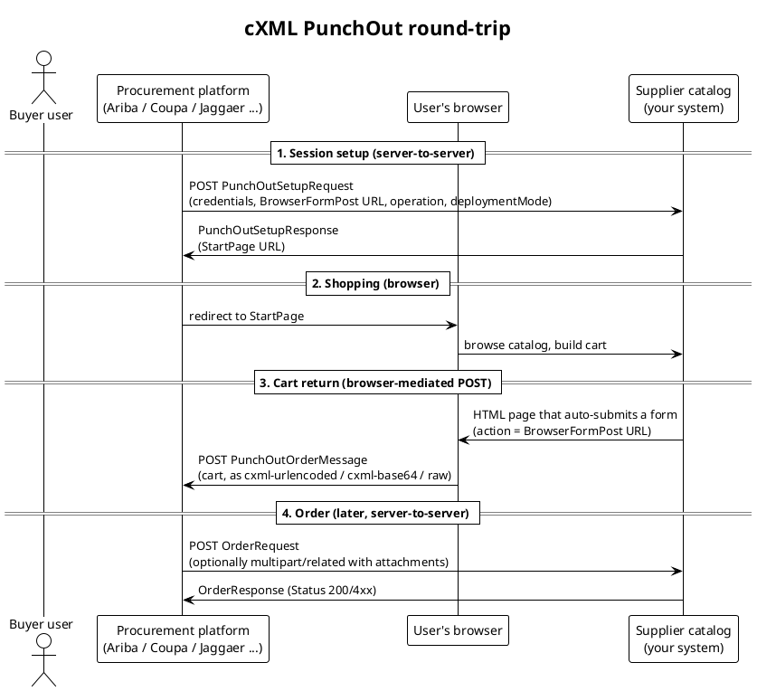
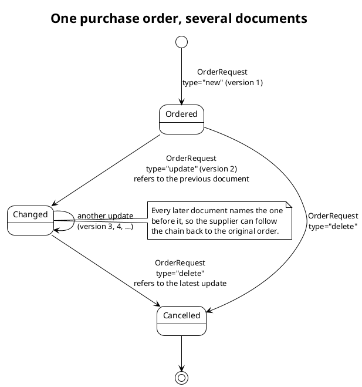
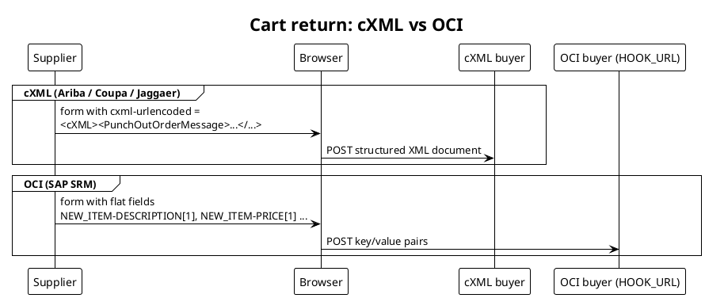
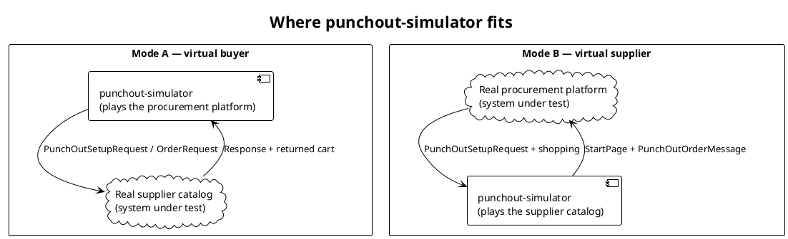

## What problem PunchOut solves

A large organization buys from many suppliers. It wants every purchase to flow
through one **procurement platform** (SAP Ariba, Coupa, Jaggaer, Oracle, Workday
…) so that spend is controlled, approvals are enforced, and orders are auditable.
But it does not want to maintain a copy of every supplier's catalog — prices,
availability, and configurable products change constantly and are best known by
the supplier.

**PunchOut** is the standard that resolves this tension. Instead of importing a
catalog, the buyer's procurement platform lets an approved user "punch out" to
the supplier's *own* live web catalog, shop there, and bring a finished cart
back into the procurement platform for approval and ordering. The supplier keeps
control of the catalog experience; the buyer keeps control of the process and
the money.

> [!NOTE]
> PunchOut is sometimes called "round-trip" or "catalog interchange". The
> dominant protocol is **cXML**, created by Ariba in 1999 and now spoken by most
> major procurement platforms. A separate older protocol, **OCI**, is covered
> briefly later for contrast.

## The actors

| Actor | Role in the process |
|---|---|
| **Buyer user (requisitioner)** | An employee who needs to buy something. Works entirely inside the procurement platform's UI. |
| **Procurement platform** | The buyer's system of record (Ariba, Coupa, …). Initiates PunchOut, enforces approvals, issues the purchase order. Also called the *buyer system*. |
| **Supplier catalog** | The supplier's web storefront, adapted to receive PunchOut sessions and return carts as structured documents. |
| **Approver / finance** | Downstream roles inside the procurement platform that approve the requisition and reconcile the invoice. |

In cXML terms the procurement platform is the **buyer** and the supplier's
catalog is the **supplier**. Every message carries credentials identifying both
parties and a shared secret proving the pair is authorized.

## The PunchOut round-trip

A complete PunchOut purchase is a *round-trip*: the user leaves the procurement
platform, shops on the supplier site, and returns with a cart — then, later, the
platform sends the actual order. There are four distinct exchanges, and they
alternate between **server-to-server** calls and **browser-mediated** posts.

*Fig. 1: The four exchanges of a cXML PunchOut round-trip.*

### Step by step

1. **Session setup.** When the user clicks "punch out to Supplier X", the
   procurement platform makes a *server-to-server* `PunchOutSetupRequest`. It
   carries the credentials, a shared secret, the `BrowserFormPost` URL where the
   cart should be returned, and flags like `operation` and `deploymentMode`. The
   supplier replies with a `PunchOutSetupResponse` containing a one-time
   **StartPage** URL.
2. **Shopping.** The user's browser is redirected to the StartPage and shops on
   the supplier's site like any web store — searching, configuring, adding to
   cart. The procurement platform is not involved during this step.
3. **Cart return.** When the user clicks "check out" or "transfer cart", the
   supplier does *not* place an order. Instead it returns the cart as a
   structured `PunchOutOrderMessage`, posted back through the browser to the
   `BrowserFormPost` URL the platform supplied in step 1.
4. **Order.** The cart lands in the procurement platform as a draft requisition.
   It goes through approval. Only then — possibly days later — does the platform
   send the real `OrderRequest` (the purchase order) server-to-server to the
   supplier, which acknowledges with an `OrderResponse`.

> [!IMPORTANT]
> The cart return is **not** an order. It is a proposal that re-enters the
> buyer's controlled process. The legally and financially meaningful document is
> the later `OrderRequest`. Confusing the two is the single most common
> conceptual mistake in PunchOut integration.

## Operations: create, edit, inspect

The `PunchOutSetupRequest` carries an `operation` attribute that tells the
supplier *why* the user is punching out:

| Operation | Business meaning |
|---|---|
| **create** | A fresh shopping trip. The user starts with an empty cart. |
| **edit** | The user already has items from this supplier in their requisition and wants to change them. The platform sends the existing line items so the supplier can **pre-load the cart**; the user adjusts and returns the revised cart. |
| **inspect** | The user wants to *view* a previously selected item on the supplier site (e.g. to re-check specs or price) without necessarily changing it. |

For `edit` and `inspect`, the procurement platform includes the existing line
items (as `ItemOut` blocks) inside the `PunchOutSetupRequest`. A
business-complete supplier honours those by restoring the cart to that state.

> [!TIP]
> The simulator supports this on both ends. The *outbound* document fully
> reflects the operation — `edit`/`inspect` carry `operation="edit"` and the
> prior cart items as `ItemOut`. The Mode-B mock supplier also *honours* an
> incoming `edit` by pre-loading the catalog (quantities pre-filled, non-catalog
> items shown as extra rows) and an `inspect` by showing the item read-only. See
> the Operations & usage guide for the details.

## Where the user starts: store, aisle or product

A user does not always enter a supplier's site through its front door. The
buyer's own catalog can list entries published by the supplier — one for the
whole store, one per product group, or one per product — and each entry is a
doorway into the supplier's site. The standard calls this the granularity of a
PunchOut item:

| Level | What the buyer's catalog lists | What the user does at the supplier |
|---|---|---|
| **Store** | One entry for everything the supplier sells. | Searches the supplier's site for what they need. |
| **Aisle** | Several entries, each for a group of related products. | Lands in the right section and picks from it. |
| **Product** | One entry per product or service. | Lands on that product; no searching. |

When the user clicks an entry, the `PunchOutSetupRequest` names it in a
**`SelectedItem`**, and the supplier decides what to show. Without one, the
supplier presents its whole store. This is often called *Level 2 PunchOut*.

The business trade-off is the supplier's: the better its own search and
configuration tools, the broader the entries can be; a supplier with a thin site
serves users better with product-level entries. For the buyer the benefit is
that users search in one familiar place — their own catalog — and still get live
prices and availability from the supplier.

> [!TIP]
> In the simulator, a session can be started *from a catalog item*, to check
> that a real supplier lands the user on that item rather than on its home page.
> The mock supplier honours a `SelectedItem` as well, opening on the product, on
> the group it matches, or on the whole store with a note when it does not know
> the item.

## How a session ends

Clicking "transfer cart" is one way out of the supplier's site, not the only
one, and what comes back does not always mean "add these items".

- **A cart with items** replaces what the session had.
- **A cancelled session.** A supplier can offer a *Cancel* button; it returns an
  empty cart, telling the buyer's system that nothing is coming and the user is
  back.
- **An empty cart after an edit** means the opposite of nothing: the items the
  user went in to change are to be **removed** from the requisition. If the user
  simply backed out, the supplier says so explicitly (a "no change" status) and
  the requisition is left as it was.
- **After an inspect**, whatever comes back is ignored. The user was only
  looking.

A supplier also states, with every cart, **what the buyer may do with it
later**: nothing more than order it, reopen it to look, or reopen it to change
it. A buyer system is expected to respect that — not to offer "edit" on a cart
the supplier marked as final.

> [!IMPORTANT]
> These cases are where integrations quietly go wrong: a buyer system that
> treats a cancelled session as an error, or one that keeps items a user deleted
> on the supplier's site. Each is easy to produce in the simulator and worth
> testing before go-live.

## The money: totals, tax, shipping and who pays

A cart and an order both carry a **total**, and the standard is specific about
what it is: the cost of the items, *excluding any tax and shipping*. Tax and
shipping are stated beside it, never folded in. A total that silently includes
them is one of the most common integration mistakes, because the two systems
then disagree by exactly the amount nobody thought to check.

Who supplies those figures is a business decision, and it differs from customer
to customer:

- **Tax** may be computed by the buying organization — it knows its own tax
  position — or quoted by the supplier with the cart. Some buyers want tax in
  the returned cart; others insist on none and add their own.
- **Shipping** is typically quoted by the supplier, since it knows what delivery
  costs, and carried into the order.
- **Cost allocation.** A buyer may attach accounting to each order line — cost
  centre, general-ledger account, project — saying who inside the organization
  pays. The supplier does not act on it, but returns it on the invoice so the
  buyer can reconcile.

Because these are agreed per customer rather than fixed by the standard,
suppliers configure them customer by customer in practice.

> [!TIP]
> The simulator mirrors that. A buyer and a supplier each have defaults for tax
> and shipping, and every buyer–supplier connection can override them — switch
> them off, or set figures specific to that pair. The validator checks the
> arithmetic and names a total that includes charges.

## After the order: changes and cancellations

A purchase order is not always final. Quantities change, a line is dropped, a
project is cancelled. cXML handles all of this with the same document that
placed the order:

- a **change order** is an `OrderRequest` marked as an update,
- a **cancellation** is one marked as a delete.

Both keep the original order number, carry a rising version, and name the
document they follow, so a supplier can always reconstruct the history of an
order from the first version to the last.

*Fig. 2: An order's life — the original, any number of changes, and possibly a cancellation, each referring to the one before.*

Suppliers differ in what they accept: some take change orders automatically,
some only before shipping, some not at all. A supplier can advertise this (see
the next section), and it is worth establishing during onboarding rather than
with the first real change.

## Finding out what a supplier supports

Before any of this, one system can simply ask the other what it can do. The
**Profile** transaction is a standard question — "which requests do you accept,
and where do I send them?" — and the answer lists them: PunchOut setup, orders,
whether attachments and change orders are accepted, and the address for each.

Where buyer and supplier are connected through a network hub, the hub asks
suppliers this periodically and keeps the answers, so buyers rarely see it. In a direct connection it is used less — the
addresses are usually exchanged by hand at onboarding — and not every supplier
answers it. Where it is supported, it is the quickest check that an endpoint is
alive, speaks cXML and accepts your credentials.

## cXML versus OCI

"Supporting PunchOut" is not a single target. The protocol family matters:

*Fig. 3: cXML returns a structured XML document; OCI returns flat form fields. They are different protocols, not versions of one.*

- **cXML** returns a structured XML document and is the dominant family (Ariba,
  Coupa, Jaggaer, Oracle, Workday).
- **OCI** (Open Catalog Interface, SAP SRM) returns flat `NEW_ITEM-*` form
  fields to a `HOOK_URL`. It is a fundamentally different protocol.

Even within cXML, platforms vary in credential style, the `deploymentMode` flag,
how the cart is posted back (`cxml-urlencoded` / `cxml-base64` / raw), how
`OrderRequest` attachments are MIME-encoded, and which extrinsic fields they
attach. A deeper treatment of these per-platform differences lives in the
companion analysis *"How Procurement Platforms Differ in PunchOut Requests"*.

> [!NOTE]
> **punchout-simulator speaks cXML only.** OCI is described here for context so
> that integrators understand why a given supplier or platform may not be a
> match for the tool.

## Where punchout-simulator fits

The hard part of PunchOut integration is that *both ends are live systems* and
each blames the other when something fails. The simulator gives you one honest,
fully inspectable end so you can isolate the real system under test.

*Fig. 4: Mode A tests a real supplier by simulating the buyer; Mode B tests a real procurement platform by simulating the supplier.*

### Two modes, two questions

- **Mode A — "is the *supplier* integration correct?"** The simulator acts as a
  virtual procurement platform. You compose and send the buyer-side documents to
  a real supplier endpoint and inspect exactly what comes back. Use this when you
  are a buyer onboarding a supplier, or a supplier validating your own catalog
  against a clean, standard buyer.
- **Mode B — "is the *buyer* integration correct?"** The simulator acts as a
  virtual supplier serving a mock catalog. A real procurement platform punches
  out to it, the user shops, and the cart is posted back. Use this when you are a
  supplier testing how a specific procurement platform talks to you, or a buyer
  validating your platform configuration against a clean, standard supplier.

### What the simulator gives you

- **A clean reference counterparty.** One end behaves to spec, so any deviation
  is attributable to the real system.
- **Full message visibility.** Every `PunchOutSetupRequest`,
  `PunchOutSetupResponse`, `PunchOutOrderMessage`, `OrderRequest` and
  `OrderResponse` is captured per session and viewable as raw cXML.
- **Validate-before-send.** Outbound documents can be checked against
  expectations (credentials, currency, address completeness, operation/item
  coherence) before they leave the tool. The rules follow the published cXML
  standard, and say plainly what a problem means for the business flow.
- **The whole life of a purchase, not just the happy path.** Punching out from
  a catalog item; a cancelled session; an emptied cart; tax, shipping and cost
  allocation, per customer; change orders and cancellations; asking a supplier
  what it supports.
- **A mock catalog that behaves like a shop,** so a test walks through the
  session the way a buyer user would.
- **Profiles and product lists.** Platform-specific quirks (cXML version,
  address mode, extrinsics) are captured as reusable buyer profiles; mock
  catalogs are reusable product lists shared across suppliers.

## A worked business scenario

A distributor is onboarding with a customer who runs Coupa. The two integration
questions can be tackled independently:

1. **Supplier proves its catalog (Mode A).** The distributor points the
   simulator's virtual buyer at its own catalog endpoint, using a Coupa-shaped
   profile. It punches out, shops, returns a cart, and sends an order — confirming
   its catalog produces a well-formed `PunchOutOrderMessage` and accepts an
   `OrderRequest`, *before* the customer's Coupa ever touches it.
2. **Buyer proves its platform (Mode B).** The customer points its Coupa instance
   at the simulator's virtual supplier. A buyer user punches out to the mock
   catalog, shops the sample assortment, and returns a cart into Coupa —
   confirming the platform's connection, credentials, and cart handling against a
   known-good supplier.

With the basics passing, each side can go on to the cases that usually surface
only in production:

3. **The awkward endings.** The distributor cancels a session, empties a cart in
   an edit, and returns a cart marked as not editable — and the customer checks
   that Coupa does the right thing with each.
4. **The money.** The connection for this customer is set to return carts
   without tax, because this customer computes its own; the order that comes
   back carries the customer's tax and cost centre, and the totals agree.
5. **A change of mind.** The customer changes a quantity on an approved order
   and later cancels it; the distributor confirms its system follows the order
   through all three documents.

When both halves pass against the simulator, the only remaining variable is the
real-to-real handshake — and both sides already know their own end is correct.
