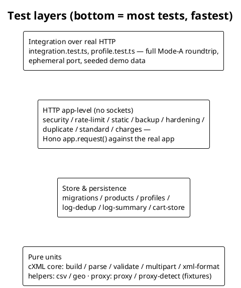
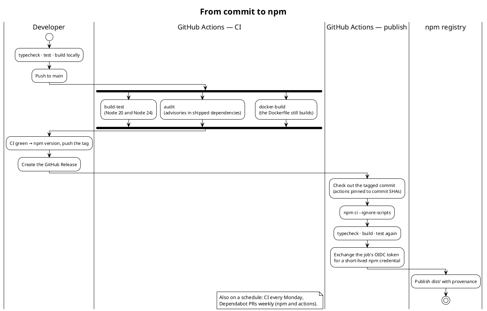

## Goals and philosophy

The simulator exists to make *other* systems' integration behaviour observable
and reproducible — so its own correctness has to be cheap to verify on every
change. The test suite is built around three principles:

- **Test the protocol logic as pure functions.** The cXML core (build / parse /
  validate / multipart) has no HTTP or storage knowledge, so most of the
  reasoning about correctness happens in fast, deterministic unit tests.
- **Make platform-specific code testable everywhere.** Anything that touches
  the OS (proxy detection, spawned commands, file reads) is written against
  injectable seams, with the parsing kept in pure functions exercised on
  captured real-world fixtures. The Windows registry parser is tested on Linux
  CI without a registry in sight.
- **One real end-to-end proof.** A full Mode-A roundtrip runs over real HTTP
  against the built-in mock supplier — the same wire path a user exercises —
  so wiring regressions can't hide between well-tested units.

There are no mocking frameworks and no test doubles beyond these seams: tests
call the real implementations on temporary data directories.

## The test pyramid

All tests live in `test/**/*.test.ts` and run under **Vitest** (`environment:
node`, 20-second timeout, one process-isolated environment per file). The suite
is currently 29 files across four layers, one of them opt-in:



*Fig. 1: Four layers — pure protocol units at the base, one real-HTTP integration proof at the top.*

### Layer 1 — pure units (cXML core and helpers)

| Suite | What it pins down |
|---|---|
| `build.test.ts` | Document emission: SetupRequest/OrderRequest shape, address and classification blocks, line-item totals (including the mixed-currency `0` total). |
| `parse.test.ts` | Inbound parsing with `fast-xml-parser`, including **XXE rejection**. |
| `validate.test.ts` | Field-level validation: credential checks only on header-bearing documents, single-currency rule and its `allowMixedCurrency` downgrade, address completeness per profile address mode, operation/items coherence. |
| `multipart.test.ts` | Hand-assembled `multipart/related` for attachments, both `binary` and `base64`. |
| `xml-format.test.ts` | The local prettifier used by the Copy/Prettify toolbar and the PDF export. |
| `csv.test.ts` / `geo.test.ts` | Product-list CSV import (header aliases, decimal-comma) and country/postal-code data. |

### Layer 2 — store and persistence

`migrations.test.ts` covers every boot migration (legacy flat connections →
normalized entities, inline catalog → product lists, `unspsc` →
classifications, address-mode backfill) against real `config.json` files in
temp directories. `products.test.ts` and `profiles.test.ts` cover entity CRUD
semantics (e.g. the `409` on deleting a referenced product list);
`log-dedup.test.ts`, `log-summary.test.ts` and `cart-store.test.ts` cover the
session-log and in-memory-cart behaviour.

### Layer 3 — HTTP app-level, no sockets

These suites call `app.request()` on the real Hono app — full middleware and
routing, no network:

- `security.test.ts` — the token gate of an exposed deployment: `401` without
  the token, the accepted token carriers (Bearer, `x-pos-token`, `?token=`), the
  open `/api/health` probe and
  the deliberately open `/sim` + `/punchout` surfaces. It also holds the
  regression tests for what an exposed instance must withstand: wrong tokens and
  wrong shared secrets being throttled per client without one client being able
  to lock out another, a forged `X-Forwarded-For` not changing who a client is,
  secrets and the `?token=` value staying out of logs, and two different
  BuyerCookies never sharing a log file. It runs in **its own
  file** so the global runtime token cannot leak into other suites (Vitest
  isolates files).
- `standard.test.ts` — behaviour taken from the cXML DTD and Reference Guide:
  date-time form, DOCTYPE and `xml:lang` rules, the element order of the tool's
  own documents, change and cancel orders (the `DocumentReference` chain and
  `orderVersion`), several credentials per party, `operationAllowed`, and how an
  empty cart is read for each operation — including the mock supplier's Cancel
  button and the buyer side keeping an inspected cart.
- `charges.test.ts` — tax, shipping and accounting: where the builders place
  them, that the `Total` stays goods-only, the validator's arithmetic and
  structure checks (including the "Total includes tax and shipping" case), and
  the round trip — the mock supplier quoting charges, the cart reading them
  back, and an order carrying either the quote or the buyer's own figures.
- `profile.test.ts` — the Profile transaction: both documents, the validation
  of a ProfileResponse, and — over real HTTP — the tool as buyer asking the tool
  as supplier, including a wrong shared secret, URLs that differ from the
  configuration, and an endpoint that does not speak cXML.
- `selected-item.test.ts` — Level 2 PunchOut: where `SelectedItem` sits in the
  SetupRequest and its validation, and the mock catalog opening on a product, a
  group, or the whole store for an unknown item.
- `schedule.test.ts` — delivery schedules: `ScheduleLine` building and its DTD
  version gate, validation, the editor's even-split helper, and — over real
  HTTP — the mock supplier confirming a plan, a rescheduling change order, and
  the note a buyer gets when its profile's DTD is too old.
- `element-order.test.ts` — the element-order check: the order table generated
  from the DTD, a warning (never an error) for children out of order, one per
  element and with the place named, and silence for repeated elements, unknown
  elements and `Extrinsic` content. The DTD suite adds that the check finds
  nothing in any document the tool builds, and flags one that `xmllint` rejects.
- `codes.test.ts` — unit and currency codes: the lists know the codes in use,
  take package codes with their `X` prefix, tell a withdrawn unit (a note, with
  its replacement) from an unknown one (a warning), report each code once, and
  the tool's own catalogs use only codes that are on the lists.
- `multi-credentials.test.ts` — several credentials per party: one `Credential`
  per identity in `From` and `To`, validation against all of a party's
  identities, a party refused when it has two values in one domain, and — over
  real HTTP — an order naming both parties twice that the mock supplier accepts.
- `catalog-page.test.ts` — the mock supplier's webshop page: the quantity
  inputs the checkout reads, the edit / inspect / preview variants, and that
  nothing a catalog or a buyer supplies is rendered unescaped.
- `rate-limit.test.ts` and `static.test.ts` — abuse limits (per-client and
  global when exposed, the looser global cap on localhost) and SPA serving.
- `backup.test.ts` — configuration export/import: secrets blanked unless asked
  for, merge vs replace, migration of older files, rejection of malformed files
  and dangling references *without writing anything*, a stored secret never
  following a connection or supplier re-pointed elsewhere, and the CSRF guard
  (cross-site `Sec-Fetch-Site` / `Origin` rejected, same-origin and header-less
  clients allowed).
- `hardening.test.ts` — the security fixes as regression tests: unsafe ids
  rejected on import and escaped in the mock catalog page, the disk budget's
  `507` and its recovery by deleting a session (orphaned attachments pruned,
  shared ones kept), anti-framing headers on the app but not on `/sim`, and the
  25 MB cap on supplier responses — the last one against a real local HTTP
  server streaming past the limit, since the cap lives in the fetch path.
- `duplicate.test.ts` — duplicating a connection with `copySecretFrom`: the
  secret is copied server-side yet stays masked in the response, a typed secret
  wins, and a different supplier or a deleted source is rejected with `400`.

### Layer 4 — integration over real HTTP

`integration.test.ts` boots the real server on an ephemeral port (`port: 0`)
with a fresh temp data directory, seeds the demo entities, and drives a **full
Mode-A roundtrip against the built-in mock supplier**: setup preview → send →
StartPage → catalog → checkout → cart return through `/punchout` → order. The
flow's outbound calls use real `fetch`, so this is the same path production
traffic takes — including the loopback proxy bypass.

## Techniques worth copying

- **Temp data directories everywhere.** Every suite that touches storage calls
  `mkdtempSync(join(tmpdir(), …))` and points the store at it — no shared
  state, no cleanup ordering problems, parallel-safe.
- **Injectable seams instead of mocks.** `setupProxy(env, log)` takes the
  env object and logger as parameters; `detectSystemProxy(platform, run,
  readFile)` takes the command-runner and file-reader. Tests substitute plain
  objects and lambdas — no mocking framework, and the production defaults stay
  one line.
- **Captured fixtures for OS parsers.** `proxy-detect.test.ts` feeds the pure
  parsers verbatim `reg query`, `scutil --proxy`, `gsettings` and `kioslaverc`
  output captured from real machines, covering manual proxies, PAC scripts and
  WPAD on all four platforms from any CI runner.
- **File-level isolation as a feature.** Global runtime state (the API token)
  is scoped by putting the suite that sets it in its own file, leaning on
  Vitest's per-file isolation instead of teardown discipline.

## Conformance to the cXML DTD

`dtd-conformance.test.ts` builds every document the tool can produce — setup
requests for each operation, new / update / delete orders, with attachments,
contacts, extrinsics, tax, shipping and accounting, both responses, and full,
empty, cancelled and charge-bearing punchbacks — and validates each against the **real cXML DTD** with `xmllint`.

It is **opt-in**. The DTD belongs to the cXML project and is not redistributed
in this repository, and the published package deliberately has no native
validator, so the suite runs only when pointed at a local copy:

```bash
CXML_DTD=/path/to/cXML/1.2.072/cXML.dtd npm test
```

Without the variable (in CI, for instance) its tests are reported as skipped.
The DTD version is read from the path and the documents are built *for that
version*, so the suite is meant to be run once per version a buyer profile
declares — 1.2.008, 1.2.011, 1.2.014, 1.2.023, 1.2.040, 1.2.045 — and once for
the current 1.2.072. That is how the two version-dependent attributes
(`addressIDDomain`, `orderVersion`) were found. Download the DTDs from
[cxml.org](https://cxml.org/downloads.html); older versions are at
`http://xml.cxml.org/schemas/cXML/<version>/cXML.dtd`.

Run it after any change to `build.ts`.

## Gates

The same three commands gate every path to a release:

| Gate | What runs | When |
|---|---|---|
| Local | `npm run typecheck` · `npm test` | Before committing; also part of the release verify gate. |
| CI (`ci.yml`) — `build-test` | `typecheck` → `build` → `test` on a **Node 20 + 24 matrix** | Every push and pull request on `main`, and every Monday. Node 20 is the declared minimum (`engines`), Node 24 the current runtime. |
| CI — `audit` | `npm audit --omit=dev --audit-level=moderate` | Same triggers. Fails on any moderate-or-higher advisory in the dependencies that ship to users; the weekly run surfaces a new advisory even when nothing is pushed. |
| CI — `docker-build` | `docker build` | Same triggers. The image isn't published anywhere; this only keeps the `Dockerfile` building. |
| Publish (`publish.yml`) | `npm ci --ignore-scripts` → `typecheck` → `build` → `test`, then `npm publish --provenance` | On GitHub Release — the suite re-runs even though CI is green, so nothing unpublishable can ship. No dependency install script runs in the job that can publish. |

Dependabot opens weekly update PRs for npm packages and GitHub Actions, which
then go through the same CI.



*Fig. 2: Local gates, three parallel CI jobs, and a publish job that repeats the suite before npm sees anything.*

> [!NOTE]
> The Node 20 leg of the matrix is what caught the `undici` 8 incompatibility
> (it requires Node ≥ 22.19) that led to pinning `undici@^6` — the matrix
> exists precisely to keep the declared minimum honest.

## What is deliberately not covered

- **The SPA has no automated tests.** The React workspace (Monaco editors,
  session views, dialogs) is verified manually in the browser. The
  highest-value SPA logic that *is* testable headlessly — XML formatting, the
  PDF report's HTML generation — lives in plain modules (`xml-format.ts`,
  `flow-pdf.ts`), and `xml-format` is unit-tested.
- **No browser end-to-end test in CI.** The Mode-B catalog and checkout are
  HTML served by the server and are covered at the HTTP layer. There is a
  headless-browser script, `scripts/verify-ui.mjs`, that walks one full session
  through the real SPA — Monaco, the embedded catalog, the order, the PDF
  export — and fails on any console error or Content-Security-Policy violation.
  It is run by hand against a running server (after UI or CSP changes), not as a
  gate: it needs a local Chromium.
- **No coverage thresholds.** Coverage is not collected; the suite grows by
  "every bug fix and feature lands with a test", not by chasing a percentage.

> [!TIP]
> When adding a feature, put the logic at the lowest layer that can express it:
> protocol behaviour in the cXML core with unit tests, storage behaviour behind
> the store suites, and extend `integration.test.ts` only when the *wiring*
> between layers is the thing that changed.
